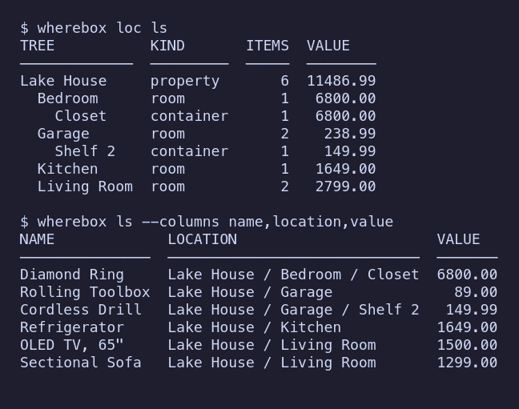

# wherebox-cli

**Know what you own, where it is, and what it is worth, from one encrypted local database on the command line.**



Personal inventory on the command line: everything you own, where it is, who
owns it, what it is worth, and the paperwork behind it. One local, encrypted
[fsqlite](https://crates.io/crates/fsqlite) (FrankenSQLite) database per
property, one binary (`wherebox`), no server, no network.

[Homebox](https://github.com/sysadminsmedia/homebox)'s CSV import is the
interop contract: `wherebox export` writes a file Homebox imports, and
`wherebox import` reads Homebox exports back. `HB.import_ref` is wherebox's
stable item id, so re-imports update items instead of duplicating them. The
design is in [docs/SPEC.md](docs/SPEC.md).

## 60-second tour

A real session, run from a clone of this repo against the synthetic data in
[`examples/`](examples). The transcript is generated by
[`scripts/readme-session.sh`](scripts/readme-session.sh), not edited by hand:
`just readme` regenerates it, and `cargo test` fails when this block no longer
matches what the binary prints. The script pins `WHEREBOX_TZ=UTC` and
`SOURCE_DATE_EPOCH` (2026-01-01), so "today" and the output are reproducible.

<!-- readme-session:begin -->
```console
$ wherebox import examples/homebox.csv
6 row(s): 6 created, 0 updated, 0 unchanged, 0 failed; 7 location(s) and 6 label(s) new, 0 lot(s)

$ wherebox loc ls
TREE           KIND       ITEMS  VALUE
─────────────  ─────────  ─────  ────────
Lake House     property       6  11486.99
  Bedroom      room           1   6800.00
    Closet     container      1   6800.00
  Garage       room           2    238.99
    Shelf 2    container      1    149.99
  Kitchen      room           1   1649.00
  Living Room  room           2   2799.00

$ wherebox add "Pressure Washer" --at Garage --price 329 --bought 2023-04-12 \
    --maker Ryobi --label tools,outdoor
added 000-007 Pressure Washer at Lake House / Garage

$ wherebox ls --label tools
ASSET_ID  NAME             ON_HAND  LOCATION                       STATUS  VALUE   LABELS
────────  ───────────────  ───────  ─────────────────────────────  ──────  ──────  ─────────────
000-007   Pressure Washer        1  Lake House / Garage            owned   329.00  outdoor,tools
000-002   Rolling Toolbox        1  Lake House / Garage            owned    89.00  tools
000-001   Cordless Drill         1  Lake House / Garage / Shelf 2  owned   149.99  power,tools

$ wherebox mv "Pressure Washer" --to "Lake House / Workshop"
created location Lake House / Workshop
moved 1 item(s) to Lake House / Workshop

$ wherebox show washer --columns asset_id,name,location,purchase_price,labels
asset_id        000-007
name            Pressure Washer
location        Lake House / Workshop
labels          outdoor,tools
purchase_price  329.00

$ wherebox history washer --columns kind,detail
KIND     DETAIL
───────  ──────────────────────────────────────────────────────────────────────
created  {"location":"Lake House / Garage","via":"add"}
moved    {"from":"Lake House / Garage","to":"Lake House / Workshop","via":"mv"}

$ wherebox ls --warranty-before 2026-06-01 --columns asset_id,name,warranty_expires
ASSET_ID  NAME          WARRANTY_EXPIRES
────────  ────────────  ────────────────
000-006   Refrigerator  2026-03-02
000-003   OLED TV, 65"  2025-11-24

$ sh examples/pantry.sh
created location Lake House / Kitchen / Fridge
added 000-008 Milk at Lake House / Kitchen / Fridge
milk (name): expires 2026-01-04 (fridge 1 week from 2025-12-28 (acquired); see `wherebox shelf-life show milk`)
added a lot of Milk (1 l, expires 2026-01-07 (fridge 1 week from 2025-12-31 (acquired)))
created location Lake House / Garage / Freezer
added 000-009 Chicken Thighs at Lake House / Garage / Freezer
raw-chicken (name): expires 2026-01-12 (freezer 9 months from 2025-04-12 (frozen); see `wherebox shelf-life show raw-chicken`)
created location Lake House / Kitchen / Pantry
added 000-010 Sourdough at Lake House / Kitchen / Pantry
bread (name): expires 2025-12-31 (printed best-by date; see `wherebox shelf-life show bread`)
added 000-011 Paper Towels at Lake House / Kitchen / Pantry

$ wherebox eat Milk 1.5
eaten 1.5 l of Milk (1.5 l left)

$ wherebox expiring --within 14d
DUE         DAYS_LEFT  STATE    ITEM            QTY   UNIT  STORAGE  LOCATION                       EXPIRY_BASIS
──────────  ─────────  ───────  ──────────────  ────  ────  ───────  ─────────────────────────────  ────────────
2025-12-31         -1  expired  Sourdough       1.00  ea    pantry   Lake House / Kitchen / Pantry  printed
2026-01-04          3  soon     Milk            0.50  l     fridge   Lake House / Kitchen / Fridge  computed
2026-01-07          6  soon     Milk            1.00  l     fridge   Lake House / Kitchen / Fridge  computed
2026-01-12         11  soon     Chicken Thighs  3.00  lb    freezer  Lake House / Garage / Freezer  computed

$ wherebox add Ribeye --preset meat.raw --at "Lake House / Kitchen / Fridge"
added 000-012 Ribeye at Lake House / Kitchen / Fridge
raw-beef (name): expires 2026-01-04 (fridge 3 days from 2026-01-01 (acquired); see `wherebox shelf-life show raw-beef`)

$ wherebox par Milk 2
par level of Milk: 2 l

$ wherebox shopping --checklist
- [ ] Milk: 0.5 l (below par: 1.5 of 2 l on hand)

$ wherebox report warranties --expiring 1y --columns warranty_expires,days_left,name,location
WARRANTY_EXPIRES  DAYS_LEFT  NAME          LOCATION
────────────────  ─────────  ────────────  ────────────────────
2026-03-02               60  Refrigerator  Lake House / Kitchen

$ wherebox export --label electronics
HB.import_ref,HB.location,HB.label,HB.quantity,HB.name,HB.asset_id,HB.description,HB.insured,HB.serial_number,HB.model_number,HB.manufacturer,HB.notes,HB.purchase_from,HB.purchase_price,HB.purchase_time,HB.lifetime_warranty,HB.warranty_expires,HB.warranty_details,HB.sold_to,HB.sold_time,HB.sold_price,HB.sold_notes,HB.field.Owner Entity,HB.field.Replacement Value,HB.field.Status
01JAEXAMP1E000000000000003,Lake House / Living Room,electronics,1,"OLED TV, 65""",000-003,Wall mounted,true,LG65-9911,OLED65C3,LG,,Costco,1899.99,2023-11-24,false,2025-11-24,,,,,,Example Family Trust,1500.00,owned
```
<!-- readme-session:end -->

## Features

* **Items** with everything Homebox tracks (quantity, maker, model, serial,
  purchase vendor/price/date, insurance, warranty, sale) plus owner entity
  (a person, trust or LLC), replacement value and valuation date, status
  (owned, lent, stored, disposed, sold, lost, gifted), labels, custom fields,
  sources (`amazon-email:<order>`) and items stored inside other items.
  Asset ids (`000-001`) are assigned automatically.
* **A location tree** of properties, rooms, containers and shelves. `--at
  Garage` finds the existing garage; `loc ls` prints the tree with item
  counts and value per room.
* **History**: an append-only event log per item (created, moved, edited,
  status changes, valuations, attachments, consumption).
* **Attachments** (photos, receipts, manuals, warranties), content-addressed
  and sealed with the database's keys.
* **Consumables**: lots with acquired, opened, frozen and thawed dates and
  their own place (fridge, freezer, pantry shelf). `use`, `eat` and `toss`
  draw from the oldest lot first; `expiring` lists perishables to eat or toss.
* **Computed shelf life**: only perishables expire. About 75 shelf-life types
  (banana, berries, milk, cheese-hard, raw-chicken, ground-meat, bread,
  opened-condiment, ...; conservative USDA FSIS FoodKeeper and FDA cold-storage
  figures per pantry, fridge and freezer, and once opened) classify items by
  name; expiry is computed from purchase, opening, freezing or thawing and
  where the lot is kept, never stored. Canned and dry goods, cleaning
  supplies and toiletries never expire. Override or add types in config
  (`wherebox shelf-life set`).
* **Estimated on hand**: a lot is presumed used up once a perishable is past
  its expiry, or a non-perishable is older than the item's reorder cadence
  (so years of tuna orders are not 72 cans on hand); `use`/`eat`/`toss` and
  `lot confirm` always win. Estimates show as `~2` in `ls`, `show`,
  `list check` and `shopping`.
* **Kind presets** (`--preset meat.raw`, `wherebox preset ls`): what a kind
  of item tracks and its defaults; a food preset names a default shelf-life
  type, safety presets set service dates (smoke alarms: replace after 10
  years, per NFPA). Every default cites its source; see
  [docs/presets.md](docs/presets.md).
* **Shopping list**: items below their par level, par items about to expire,
  and learned reorders (the median gap between purchases, or a `Recurring`
  field) with the last purchase, cadence and days overdue, as a table, a
  Markdown checklist or a cart-ready CSV, for one property or all.
* **Insurance report**: every owned durable with location, maker/model/serial,
  purchase and replacement value, photo and receipt paths, room subtotals,
  property and grand totals, and the gaps an adjuster will ask about; CSV,
  XLSX, HTML or PDF, for one property or all. Rented properties say
  "contents only". `report warranties` lists warranties ending soon.
* **One database per property** (`--profile lake-house`), each with its own
  keys, location tree and audit log.
* **Homebox CSV** import and export (byte-stable round trip), plus wherebox's
  own CSV, JSON and JSONL, generic CSV/TSV with a column mapping, and
  spreadsheets (xlsx, xls, ods). Imports run in one transaction with
  `--dry-run`.
* Every command supports `--format` (table, json, jsonl, csv, tsv, yaml,
  toon, markdown, html, org) and `--output FILE`; `--json` gives the stable,
  versioned `wherebox/v1` envelope ([docs/json-schema.md](docs/json-schema.md))
  for scripts and agents.
* Layered configuration: defaults < TOML file < `WHEREBOX_*` env < flags.
* **Encrypted at rest, with nothing to set up**: an XChaCha20-Poly1305 sealed
  container locked to your SSH key by default (or a private key file), on
  macOS, Linux and Windows. An encrypted audit log records who did what.
  Exports can be age-encrypted. See [Encryption](#encryption).

## Install

**Release archives.** Each [release](https://github.com/davidawad/wherebox-cli/releases)
carries `wherebox-<version>-<target>.tar.gz` for the targets it was built on,
and a `SHA256SUMS` file. Each archive holds the `wherebox` binary, man pages
(`man/`) and shell completions (`completions/`). (0.1.0 used
`wherebox-cli-v0.1.0-<target>.tar.gz`, without man pages or completions.)

```sh
v=0.2.0 t=aarch64-apple-darwin   # the release you want, and your target
curl -LO https://github.com/davidawad/wherebox-cli/releases/download/v$v/wherebox-$v-$t.tar.gz
curl -LO https://github.com/davidawad/wherebox-cli/releases/download/v$v/SHA256SUMS
sha256sum --ignore-missing -c SHA256SUMS     # macOS: shasum -a 256 --ignore-missing -c SHA256SUMS
tar xzf wherebox-$v-$t.tar.gz && install wherebox-$v-$t/wherebox ~/.local/bin/
```

**From source** (fsqlite needs a nightly toolchain on x86_64 and on Windows,
see [Build](#build); aarch64 builds on stable):

```sh
cargo +nightly install --locked --git https://github.com/davidawad/wherebox-cli   # x86_64, Windows
cargo install --locked --git https://github.com/davidawad/wherebox-cli            # aarch64
```

See [docs/platforms.md](docs/platforms.md) for what differs per OS (key
storage, file locations, permissions).

## Build

fsqlite 0.4 enables unstable Rust features on x86_64 (`core_intrinsics`, for
prefetch hints in its pager and B-tree) and on Windows (`windows_by_handle`, in
its VFS), so those targets need a **nightly** toolchain. `rust-toolchain.toml`
selects nightly automatically under rustup. aarch64 Linux and Apple Silicon
also build on stable (`cargo +stable build`), which CI checks.

```sh
cargo build --release          # target/release/wherebox
cargo install --path .         # or install into ~/.cargo/bin
```

Debug builds of fsqlite use deep async state machines. The binary runs its
work on a thread with a 256 MiB stack, so no `ulimit` tweaks are needed.

## Quick start

```sh
wherebox profile init lake-house              # Lake House: its own encrypted database
wherebox config set profile lake-house        # the default property from now on

wherebox add "Cordless Drill" --at "Garage / Shelf 2" --price 149.99 --bought 2024-05-01 \
  --from "Home Depot" --maker DeWalt --model DCD777 --serial DCD777-0042 \
  --label tools,power --owner "Family Trust" --warranty-expires 2027-05-01
wherebox add "Toolbox" --at Garage
wherebox edit drill --inside Toolbox --field "Battery=20V"
wherebox attach drill ~/receipts/drill.pdf --kind receipt
wherebox value "OLED TV" 1500 --on 2025-06-01
wherebox mv drill toolbox --to "Workshop"
wherebox rm "Old TV" --as sold --to Neighbor --price 75

wherebox ls                                 # everything on hand, by location
wherebox ls --at Garage --label tools
wherebox ls --warranty-before 2026-06-01    # warranties about to run out
wherebox find dewalt                        # name, description, serial, model, notes
wherebox show drill                         # all fields, lots, attachments, history
wherebox history drill
wherebox loc ls                             # the tree with counts and value

wherebox add Milk --at "Kitchen / Fridge" --unit l --lot-qty 2   # expires in a week: computed
wherebox lot add Milk 1
wherebox lot add Yogurt 4 --best-by 2026-01-20   # a printed date wins (perishables only)
wherebox eat Milk 1.5                       # oldest lot first
wherebox toss Milk --spoiled                # the whole oldest lot
wherebox expiring --within 3d               # perishables only
wherebox lot confirm "Dish Soap" --qty 2    # still on hand: resets the estimate
wherebox shelf-life ls                      # ~75 types: banana, milk, raw-chicken, ...
wherebox shelf-life set milk --fridge 5d    # override (or add a type) in config.toml

wherebox export -o lake-house.csv             # Homebox CSV
wherebox import lake-house.csv --dry-run      # what would change
```

Items are named by asset id (`000-001`), id (or a unique id prefix or
suffix), import ref, exact name, or a unique part of the name (`drill`).

## Properties (profiles)

Each property is its own wherebox: a separate database, with its own keys,
location tree and audit log. Declare each property in the config file (see
below), or create one directly with
`wherebox profile init lake-house --title "Lake House"`.

```sh
wherebox profile ls                         # known properties, which exist, which is active
wherebox profile init cabin --title Cabin   # create the database and its top-level location
wherebox --profile rental-apt add Kettle --at Kitchen   # -> "Rental apartment / Kitchen"
WHEREBOX_PROFILE=beach-house wherebox ls
wherebox profile show lake-house              # item count and value without switching
```

`--profile NAME` (or `WHEREBOX_PROFILE`, or `profile` in the config file)
selects `<data dir>/wherebox-cli/profiles/NAME.db`. More properties, or other
paths, go in the config file:

```toml
[profiles.lake-house]
title = "Lake House"
address = "1 Shore Rd"
db_path = "~/vaults/lake-house.db"   # optional
rented = true                        # optional: a rental (insurance reports say "contents only")
```

Set `rented = true` for a rental. `shopping --all-profiles` and
`report insurance --all-profiles` roll up every property that has a
database.

## Presets, shopping and reports

```sh
wherebox preset show meat.raw               # what it tracks, shelf-life type, sources
wherebox add Ribeye --preset meat.raw --at "Kitchen / Fridge"     # expires in 3 days
wherebox lot add Ribeye 2 --at "Garage / Chest Freezer"           # frozen: 4 months
wherebox add "Hall smoke alarm" --preset smoke-detector --field Installed=2021-05-01
                                            # Replace By 2031-05-01, Next Inspection
wherebox par "Paper Towels" 4 --reorder 12
wherebox shopping --all-profiles --checklist
wherebox shopping -P rental-apt -f csv -o cart.csv
wherebox report insurance --all-profiles -f pdf -o insurance.pdf
wherebox report insurance -P rental-apt -f xlsx -o rental-apt.xlsx
wherebox report warranties --expiring 90d
```

The insurance report counts owned durables: items that are not gone and not
consumables (no lots; no `Kind` field of `consumable`, no food or consumable
preset, no `consumable` or `food` label). A line's unit value is the
replacement value, else the purchase price (flagged `*`); its line value is
unit value x quantity, and totals add line values. `--min-value 250` keeps
lines worth at least that, `--bought-after 2020-01-01` items bought on or
after a date. Gaps list items without a value, a photo, a receipt, (for kinds
whose preset tracks `serial`) a serial number, and "verify still owned" for
items bought more than 10 years ago that are still marked owned; the report
counts each. XLSX and PDF are binary, so give `--output`. The PDF is written
by wherebox itself (built-in Courier fonts, no external tools).

Reorders come from purchase history: with three or more purchases (lot
acquisition dates), the cadence is the median gap between them, and an item is
due once that long has passed since the last purchase, unless an unused lot
was acquired within the last cadence. With less history, a `Recurring` custom
field (`HB.field.Recurring` in Homebox CSV) gives the interval (`9d`, `2w`,
`monthly`); `yes`/`true` takes `HB.field.Avg Interval Days`, else the gap
between two purchases. Items last bought more than `--since` months ago
(default 18) are treated as dropped, not due.

### Consumables bought again and again

A consumable bought many times is one item with a lot per purchase, so the
shopping list can learn its cadence. On import, rows for a consumable (a
`HB.field.Kind` of `consumable`, a food or consumable preset, or a
`consumable`/`food` label) that share `HB.field.ASIN` (else a product ref) at
the same property become one item: the latest row's fields, the first row's
import ref, and a lot per row with its quantity, purchase date, unit price and
the row's import ref, so importing the same orders again (or a later file with
more) only adds what is new. Durables stay one item per row. Databases
imported before this work this way after `wherebox db regroup-consumables`
(`--dry-run` first to see the plan; safe to run again).

An explicit `--db FILE` beats `--profile`; `--profile` beats `WHEREBOX_DB`.
In a database that holds a single property, new places typed with `--at`
(`--at Kitchen`) are created under that property.

## Lists, cohorts and matching

"Do we have the ingredients for nutty pudding at the Beach House?" Lists (recipes,
kits, packing lists, wishlists) are TOML files under `<config
dir>/lists/`, shared by every property, hand-editable and git-able; CLI edits
keep your comments.

```sh
wherebox list new "Nutty pudding" --type recipe -P beach-house   # default profile beach-house
wherebox list import nutty-pudding recipe.txt                # "200 g walnuts", "3 eggs", URLs
wherebox list add nutty-pudding nuts --qty 300 --unit g --cohort nuts --optional
wherebox list check nutty-pudding && echo ready              # exit 0 ready, 3 not ready
wherebox list shop nutty-pudding                             # the shortfall, as shopping rows
wherebox shopping --include-list nutty-pudding
wherebox list explain nutty-pudding walnuts                  # why it matched (or didn't)
wherebox list pin nutty-pudding walnuts 000-012              # confirm a match
wherebox cohort new nuts --any walnuts pecans almonds cashews --label nuts
wherebox match "walnut halves" -P beach-house                     # the ladder without a list
```

No single key identifies a product, so an entry is matched on a ladder,
highest confidence first, and every match reports its tier and score:
identifiers (ASIN, SKU, UPC/GTIN, product ref, normalized), URLs (Amazon
`/dp/<ASIN>`; tracking parameters dropped), pins, labels and presets, then a
fuzzy product-name match (sizes, pack counts and marketing words dropped;
threshold `match_threshold`, 0.82). Close fuzzy candidates are flagged
ambiguous; `exclude` always wins and `at` narrows to a place. Quantities
convert between g/kg/oz/lb and ml/l/tsp/tbsp/cup (an `ea` item whose name
says `16 oz` counts as 16 oz); expired lots are reported, not counted.
Details: docs/SPEC.md, "Lists and matching".

## Homebox CSV

`wherebox export` (or `--format homebox`) writes exactly the columns of
Homebox's [CSV import](https://github.com/sysadminsmedia/homebox/blob/main/docs/src/content/docs/en/advanced/import-csv.mdx):
`HB.import_ref`, `HB.location` (the full path, `Lake House / Garage /
Shelf 2`), `HB.label` (comma list), the standard columns `HB.quantity` …
`HB.sold_notes`, and `HB.field.<Name>` custom fields. Fields Homebox lacks
travel as custom fields:

| wherebox | Homebox column |
|----------|----------------|
| owner entity, replacement value, valued at, status | `HB.field.Owner Entity`, `HB.field.Replacement Value`, `HB.field.Valued At`, `HB.field.Status` |
| kind preset, unit, par level, reorder qty, vendor, product ref, shelf-life type | `HB.field.Preset`, `HB.field.Unit`, `HB.field.Par Level`, `HB.field.Reorder Qty`, `HB.field.Vendor`, `HB.field.Product Ref`, `HB.field.Shelf Life` |
| sources | `HB.field.Source` (`amazon-email:113-55; manual`) |
| custom fields | `HB.field.<Name>` |
| item stored inside another | last line of `HB.notes`: `Inside: <name> (wherebox:<id>)` |
| lots | one row per active lot: import ref `<item ref>#lot:<lot id>`, `HB.field.Lot Qty`, `Acquired`, `Opened`, `Best By` (printed; `Expires` is read as one on import), `Frozen`, `Thawed`, `Lot Status`, `Lot Price` (one unit), `Lot Ref` (the purchase row it came from) |

Attachments do not travel in CSV (a Homebox limitation). Money is dollars
(`1299.99`), dates `YYYY-MM-DD`, booleans `true`/`false`.

`wherebox import FILE` detects Homebox CSV (or TSV) from its `HB.` header and
upserts: a row whose `HB.import_ref` matches an item updates it (columns not
in the file are kept; an empty standard column clears the value; empty
`HB.field.*` cells are ignored, as in Homebox). New refs create items; a
wherebox id as the ref becomes the item id. Receipt intake can use refs such
as `amazon:<order>:<line>` and review with `--dry-run`. Export -> import ->
export is byte-stable, and `tests/homebox.rs` checks it.

## Importing other files

```sh
wherebox import things.csv --mapping things-mapping.toml   # generic CSV
wherebox import inventory.xlsx --sheet Stuff --header-row 3
wherebox import backup.json                                # wherebox's own export
wherebox import list.csv --at "Garage" --label imported --dry-run
```

Generic CSV/TSV and spreadsheet headers match item fields by name
(`name`, `quantity`, `purchase_price`, `serial_number`, …), by common synonyms
(`Item`, `Qty`, `Price`/`Cost`/`Paid`, `Bought`, `Brand`/`Maker`, `Serial`,
`Model`, `Where`/`Room`, `Tags`, `Owner`), or by an explicit mapping
(`--map FIELD=COLUMN`, or a TOML file, see
[`examples/things-mapping.toml`](examples/things-mapping.toml)):

```toml
date_format = "%m/%d/%Y"
[columns]
location = "Room"
"field.Color" = "Colour"       # a custom field
[defaults]
owner_entity = "Family Trust"   # for rows without one
```

`wherebox export -f json` (or `jsonl`, `csv`, `yaml`, `toon`) writes
wherebox's own records (every field, lots nested), which import back
unchanged. Bad rows abort the import (nothing is written) unless
`--skip-invalid`; columns that match nothing are listed, not imported.

## Encryption

Everything wherebox writes is encrypted, and you do not have to set anything
up. The first command creates an encrypted database locked to your SSH key
(`~/.ssh/id_ed25519`, then `~/.ssh/id_rsa`; `%USERPROFILE%\.ssh` on
Windows). It tells you which key (path and fingerprint) and, on a terminal,
asks before using it. From then on it just opens; nothing prompts. If your
SSH key has a passphrase, wherebox also makes a private key file so daily use
stays prompt-free and the SSH key becomes the recovery key. With no SSH key
it uses a key file (owner-only, under the config directory). wherebox never
uses the OS keychain, so it behaves the same on macOS, Linux and Windows.

```sh
wherebox key status            # which keys open the database, and how to recover it
wherebox key add-ssh ~/.ssh/laptop.pub   # another machine's key (or an offline recovery key)
wherebox key add-passphrase    # a passphrase you can write down
wherebox db rekey --to ssh     # replace every key with your SSH key
export WHEREBOX_KEY="raw:$(openssl rand -hex 32)"   # CI / scripts; or a passphrase
wherebox db encrypt            # migrate a plaintext database (and its attachments) in place
wherebox doctor                # encryption, keys, permissions, audit-log check
wherebox audit log -n 20       # who did what (no values are logged)
wherebox export --recipient age1... -o lake-house.csv.age
```

Attachments live in `attachments/<item id>/` next to the database, one file
per SHA-256, sealed with a key derived from the database's long-term data
key. Plaintext databases need `--insecure-plaintext` and print a warning
every time. [docs/security.md](docs/security.md) covers the design and the
threat model. Keep at least one key somewhere else: lose them all and the
data cannot be recovered.

## Commands

| command | purpose |
|---------|---------|
| `add NAME` | add an item (`--at`, `--qty`, `--price`, `--bought`, `--from`, `--serial`, `--model`, `--maker`, `--owner`, `--label`, `--field NAME=VALUE`, `--source`, `--inside`, lot dates …) |
| `edit ITEM` | change fields (`--clear FIELD`, `--label`/`--unlabel`, `--at`, `--inside`/`--not-inside`) |
| `mv ITEM... --to LOC` | move items |
| `rm ITEM [--as disposed\|sold\|gifted\|lost]` | mark an item gone; `--purge` deletes it |
| `show ITEM` | all fields, lots, attachments, history |
| `ls` | list (`--at`, `--label`, `--owner`, `--status`, `--all`, `--warranty-before`, `--inside`, `--sort`, `-n`) |
| `find TEXT` | search name, description, serial, model, notes |
| `history ITEM` | the item's events |
| `value ITEM AMOUNT [--on DATE]` | record a replacement value |
| `loc add\|ls\|mv\|edit\|rm` | the location tree |
| `label add\|ls\|rm` | labels |
| `attach ITEM FILE [--kind]` | attach a photo, receipt, manual or warranty |
| `attachment ls\|get\|rm` | list, extract (decrypted) or remove attachments |
| `lot add\|ls\|edit\|rm` | lots of a consumable |
| `lot confirm ITEM [--qty N] [--lot L]` | still on hand today (resets the "presumed used up" estimate; with `--qty` draws down to N) |
| `use`, `eat`, `toss ITEM [QTY]` | log consumption, oldest lot first |
| `expiring [--within 3d]` | perishable lots expiring soon or already expired (computed expiry) |
| `preset ls\|show NAME` | kind presets: what they track, defaults, alerts, sources |
| `shelf-life ls\|show T\|set T [--pantry --fridge --freezer --opened D] [--synonym S]\|reset T` | shelf-life types; `set` writes `[shelf_life.T]` in config.toml |
| `par ITEM N [--reorder Q]` | keep at least N on hand (`none` clears it) |
| `shopping [--all-profiles] [--within 7d] [--since 18] [--checklist] [--include-list L]` | what to buy: below par, expiring par items, learned reorders, list shortfalls |
| `list new\|ls\|show\|rm\|add\|edit\|drop\|import` | lists: recipes, kits, packing lists, wishlists |
| `list check\|shop\|explain\|pin\|unpin LIST` | have it? (exit 3 when not ready), what to buy, why it matched, confirm a match |
| `cohort new\|ls\|show\|add\|rm` | named, reusable matchers (`nuts` = walnuts, pecans, label nuts) |
| `match [QUERY] [--asin --upc --url ...]` | the matching ladder over a profile, without a list |
| `report insurance [--all-profiles] [--owner O] [--min-value N] [--bought-after DATE] -f csv\|xlsx\|html\|pdf` | insurance inventory with totals and gaps |
| `report warranties [--expiring 90d] [--all-profiles]` | warranties ending soon |
| `import FILE` | Homebox CSV, wherebox CSV/JSON/JSONL, generic CSV, spreadsheets |
| `export` | Homebox CSV (default), or `-f csv\|json\|jsonl` |
| `profile ls\|init\|show` | properties |
| `db regroup-consumables [--dry-run]` | one item per consumable with a lot per purchase (for databases imported before) |
| `db`, `key`, `audit`, `config`, `doctor` | maintenance, keys, audit log, settings, health check |
| `completions SHELL`, `man` | shell completions, man pages |

`wherebox COMMAND --help` lists every flag.

## Output formats

`--format` / `-f` (or the `format` setting): `table` (default), `json`
(the versioned envelope), `jsonl`, `csv`, `tsv`, `yaml` and `toon` (the JSON
envelope), `markdown`, `html`, `org`; `report insurance` also writes `xlsx`
and `pdf` (and a standalone HTML document). `--json` is short for `-f json`.
`--columns a,b,c` picks columns in text formats, `--precision`,
`--date-format`, `--null`, `--delimiter`, `--no-header` shape them, and
`-o FILE` writes owner-only files. Mutating commands print only a status line
on stderr in table mode, and the changed record otherwise.

## Configuration

Settings resolve in this order, lowest to highest precedence: built-in
defaults; the config file (`--config FILE`, else `$WHEREBOX_CONFIG`, else
`$XDG_CONFIG_HOME/wherebox-cli/config.toml`, default
`~/.config/wherebox-cli/config.toml`; on Windows
`%APPDATA%\wherebox-cli\config.toml`); `WHEREBOX_*` environment variables
(`NO_COLOR` is honoured too); command-line flags.

| key | env | default | values |
|-----|-----|---------|--------|
| `db_path` | `WHEREBOX_DB` | `$XDG_DATA_HOME/wherebox-cli/wherebox.db` | path (`~` expanded) |
| `profile` | `WHEREBOX_PROFILE` | — | property profile (see [Properties](#properties-profiles)) |
| `expiring_within` | `WHEREBOX_EXPIRING_WITHIN` | `7d` | default look-ahead of `expiring` |
| `default_cadence` | `WHEREBOX_DEFAULT_CADENCE` | `90d` | how long a non-perishable lot is presumed on hand without a learned cadence; `[cadence]` sets it per preset or category (`household = "60d"`) |
| `match_threshold` | `WHEREBOX_MATCH_THRESHOLD` | `0.82` | fuzzy name-match threshold of lists, cohorts and `match` |
| `format` | `WHEREBOX_FORMAT` | `table` | `table json jsonl csv tsv yaml toon markdown html org homebox` |
| `date_format` | `WHEREBOX_DATE_FORMAT` | `%Y-%m-%d` | strftime, for display and accepted on input |
| `timezone` | `WHEREBOX_TZ` | `local` | `local`, `UTC`, IANA name, `+HH:MM` |
| `color` | `WHEREBOX_COLOR` | `auto` | `auto always never` |
| `precision` | `WHEREBOX_PRECISION` | `2` | decimals in text formats |
| `csv_delimiter`, `csv_quote`, `csv_header` | `WHEREBOX_CSV_*` | `,` `"` `true` | |
| `null` | `WHEREBOX_NULL` | empty | text for missing values |
| `key_source`, `ssh_key`, `key_file` | `WHEREBOX_KEY_SOURCE`, … | `auto` | see [Encryption](#encryption) |
| `quiet` / `verbose` | `WHEREBOX_QUIET` / `WHEREBOX_VERBOSE` | `false` | bool |

```sh
wherebox config set profile lake-house
wherebox config show --effective     # every value and where it came from
wherebox config keys
```

The config file is flat TOML; one level of tables is flattened (`[csv]
delimiter = ";"` is `csv_delimiter = ";"`). `[profiles.NAME]` tables describe
properties and `[encryption]` is wherebox's record of database keys. See
[`examples/config.toml`](examples/config.toml).

## Machine interface

`--json` on any command returns a versioned envelope:

```json
{"schema": "wherebox/v1", "kind": "items", "generated_at": "…", "count": 1, "total_value": 149.99, "data": [{"id": "01J…", "asset_id": "000-001", "name": "Cordless Drill", …}]}
```

The fields, all `kind`s, the error object, and the exit codes (0 ok, 1 error,
2 usage, 3 not found, 4 invalid data, 5 database, 6 io, 7 config, 8 key) are
documented in [docs/json-schema.md](docs/json-schema.md).

## Data model

SQLite schema, managed by versioned migrations in `src/migrations.rs`:

* `items`: id (ULID), import ref, asset id, every Homebox field, owner entity,
  replacement value, status, consumable fields (unit, par level, reorder qty,
  vendor, product ref, kind preset, shelf-life type); money in cents, dates `YYYY-MM-DD`
* `locations(id, name, parent_id, kind property|room|container|shelf|fridge|freezer|pantry, address)`
* `labels`, `item_labels`; `item_fields(item_id, name, value)`
* `attachments(item_id, kind, path, sha256, primary, …)`;
  `sources(item_id, source, ref)`
* `events(item_id, at, kind, detail)`: append-only history
* `lots(id, item_id, qty, acquired_at, opened_at, best_by (printed),
  frozen_at, thawed_at, confirmed_at, location_id, status
  sealed|open|consumed|discarded)`; expiry is computed, never stored, and
  `expires_at` stays empty; and
  `consumption(lot_id, qty, at, reason eaten|used|spoiled|discarded)`
* `import_batches`

Kind presets are TOML files (`presets/kinds/`, compiled in; overrides in
`<config dir>/presets/kinds/`), not tables: an item names its preset in
`kind_preset`.

## Development

```sh
cargo fmt
cargo clippy --all-targets -- -D warnings
cargo test        # unit tests + assert_cmd integration tests
just test-gate    # all three, as run before merging
just readme       # regenerate the README session
just release 0.2.0   # cut a release, see docs/releasing.md
WHEREBOX_BLESS=1 cargo test --test homebox --test formats   # rewrite golden files
```

All data in `examples/` is synthetic.
